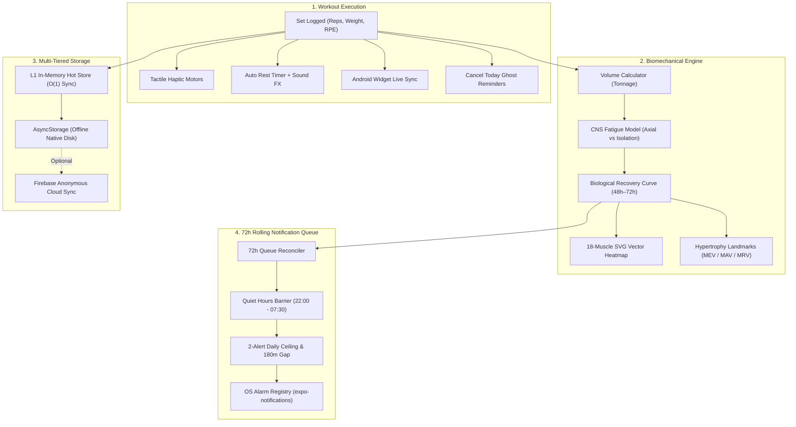

<div align="center">

<p>
  
</p>

# ZenFit

### The pure native, offline-first lifter platform with closed-loop biomechanics.

<p>
  <a href="https://github.com/ShivanshSingh158/Zenfit/stargazers"></a>
  <a href="https://github.com/ShivanshSingh158/Zenfit/releases"></a>
  <a href="LICENSE"></a>
  <a href="https://reactnative.dev"></a>
  <a href="https://expo.dev"></a>
  <a href="https://www.typescriptlang.org"></a>
  <a href="https://developer.android.com"></a>
</p>

<p>
  <a href="https://github.com/ShivanshSingh158/Zenfit/releases/latest"></a>
</p>

[Why ZenFit](#why-zenfit) · [Features](#features) · [What ZenFit is Not](#what-zenfit-is-not) · [Biomechanical Architecture](#biomechanical-architecture) · [Quickstart](#quickstart) · [Roadmap](#roadmap) · [License](#license)

</div>

---

## Why ZenFit

Most workout trackers keep your workout history hostage behind monthly subscriptions, harass you with invasive ads, leak your biometric data to third-party brokers, or package sluggish web apps inside bloated WebView wrappers that lag when your hands have chalk on them.

**ZenFit is engineered differently:**

- **100% Free & Open Source:** No paywalls, no "pro" tiers, and no locked features. Everything is yours forever.
- **Pure Native 120Hz Fluidity:** Built directly on **React Native 0.76** with the C++ Fabric Core and Yoga layout engine—not a browser DOM wrapped in Capacitor.
- **Zero Latency & Offline-First:** Every tap, set checkmark, rest timer countdown, and 1RM calculation resolves instantly in under 16ms with an L1 in-memory hot cache.
- **Academic Biomechanical Intelligence:** Real-time muscle recovery curves (48h–72h), CNS fatigue scaling, structural symmetry ratios, and Dr. Mike Israetel's Hypertrophy Volume Landmarks (MEV/MAV/MRV).
- **Zero Telemetry & Private by Design:** All workout logs, body metrics, and split templates remain stored directly on your device. Anonymous cloud sync is completely optional.

---

## Features

### 🏋️ Active Session HUD & Fast Logging
- **4-Column Dedicated Lifter Keypad:** Fast numpad entry with `+2.5kg` / `+1 rep` contextual steppers designed for one-handed thumb entry while standing at the rack.
- **Swipe-to-Complete Sets:** Swipe set rows horizontally to log completion, auto-trigger hardware haptic vibration feedback, and launch the rest timer.
- **Auto-Rest Countdown with Acoustic Cues:** Real-time countdown timer with 3-2-1 acoustic audio countdown cues generated directly via a low-latency PCM audio synthesizer (`expo-av`).
- **Persistent Lockscreen Alert:** Ongoing foreground service alert keeps your active exercise, next target weight/reps, and rest countdown visible without unlocking your phone.
- **Live In-Workout Exercise Swapping:** Swap movements mid-session with automatic 1RM equivalence and muscle group matching.

### 📅 Planning & Split Architecture
- **Curated Multi-Day Programs:** Built-in battle-tested programs: Push/Pull/Legs (PPL), Upper/Lower, Arnold Split, Full Body, and 5×5 Strength.
- **Direct Exercise Scheduling:** Day-by-day scheduler with automatic muscle group permutation titles (e.g. *Chest & Back Thickness*).
- **Pre-Session Muscle Hit Map:** Mini visual mannequin preview on each workout card lighting up the exact anatomical heads targeted before you begin.
- **Tactile Volume Tuning:** Configure target sets, rep ranges, rest intervals, and warm-up cascades per movement.
- **Deload & Rotation Modes:** Switch seamlessly between fixed weekday plans and continuous rotations (Day A → Day B → Day C).

### 🧬 Biomechanical Recovery & Vector Mannequin
- **18-Muscle Interactive Vector Mannequin:** Anterior and posterior SVG vector body map visualizing live tissue recovery across 18 muscle groups in real time.
- **Closed-Loop CNS & Tissue Recovery:** Differentiates recovery kinetics—48 hours for smaller muscles (biceps, lateral delts) vs. 72 hours for heavy axial loading (deadlifts, squats) based on RPE and cumulative tonnage.
- **Hypertrophy Volume Landmarks (MEV / MAV / MRV):** Automatically classifies weekly set volume into Dr. Mike Israetel's scientific hypertrophy tiers:
  - `Untrained (0 sets)`: Baseline maintenance deficit.
  - `Maintain (4–6 sets)`: Minimum Effective Volume (MEV).
  - `Growth Zone (10–16 sets)`: Maximum Adaptive Volume (MAV).
  - `Overworked (20+ sets)`: Maximum Recoverable Volume (MRV).
- **Structural Symmetry Balance:** Computes push-to-pull, quad-to-hamstring, and upper-to-lower volume ratios to prevent postural imbalances and joint wear.

### 🔔 72-Hour Rolling Predictive Notifications
- **Relative Time Anchoring (`T-Offset`):** Reminders are keyed to your preferred workout time `T` (e.g., `T - 45m` pre-workout readiness, `T + 60m` missed session recovery catch), adapting to morning, afternoon, or evening lifters.
- **2-Notification Daily Ceiling:** Enforces an unbreachable 2-notification daily limit with mandatory 180-minute spacing to eliminate alert fatigue.
- **Quiet Hours Barrier:** Hard quiet barrier between `22:00` and `07:30` prevents disturbances during sleep and biological tissue repair windows.
- **Ghosting Backoff Protection:** Automatically silences habit reminders after 3 consecutive unlogged sessions until the app is reopened, preventing user guilt-trips.
- **Sunday Strength Briefing:** Weekly digest delivered Sunday morning summarizing total tonnage, volume progression, and muscle recovery readiness for the upcoming split.

### 📱 Android Home Screen Widget & Hardware Integration
- **Live Workout Home Screen Widget:** Android App Widget displaying current exercise, active set status, and live rest countdown without entering the app.
- **Tactile Haptic Engine:** Differentiated haptic profiles (`ImpactFeedbackStyle.Heavy` on set completion, `NotificationFeedbackType.Success` on PR milestones).
- **Bluetooth & Geofence Readiness:** Hardware hooks to prompt your workout routine upon connecting gym headphones or arriving at your gym facility.

---

## What ZenFit is Not

- **Not a Social Network:** No influencer feeds, no vanity selfies, no follower counts, and no algorithmic engagement traps. ZenFit is a focused utility built for the iron.
- **Not a Web App in a WebView:** ZenFit does not bundle a web browser or DOM engine. It compiles directly to native iOS and Android view hierarchies via React Native's modern Fabric C++ architecture.
- **Not a Cloud Dependency:** You can take ZenFit into a subterranean basement gym with zero cellular reception or Wi-Fi, log an entire 2-hour workout, inspect your volume analytics, and everything will function flawlessly.
- **Not a Subscription Subscription:** No locked exercise videos, no restricted routine slots, and no paywalls for viewing your 1RM progression charts.

---

## Biomechanical Architecture



---

## Tech Stack

| Layer | Technology | Purpose |
| :--- | :--- | :--- |
| **Framework** | [React Native 0.76](https://reactnative.dev) | Native Fabric C++ Architecture & Yoga Layout Engine |
| **Tooling** | [Expo SDK 52 (Bare)](https://expo.dev) | Hardware access, bare workflow native modules, and EAS builds |
| **Language** | [TypeScript 5.x](https://www.typescriptlang.org) | 100% strict type safety, zero `any` in core domains |
| **Gestures & Animations**| [Reanimated 3](https://docs.swmansion.com/react-native-reanimated/) | 120 FPS UI thread animations, spring physics, and swipe gestures |
| **Vector Anatomy** | [React Native SVG](https://github.com/software-mansion/react-native-svg) | Hardware-accelerated 18-muscle vector mannequins |
| **Home Screen Widgets** | [react-native-android-widget](https://github.com/sA等级/react-native-android-widget) | Android Glance native home screen live workout HUD |
| **Storage & Cache** | `AsyncStorage` + L1 Hot Store | Multi-tier offline-first storage hierarchy |
| **Audio Synthesis** | `expo-av` | Low-latency PCM acoustic cue synthesizer for rest timers |
| **Haptics** | `expo-haptics` | Hardware tactile vibration feedback |

---

## Quickstart

### Prerequisites
- [Node.js](https://nodejs.org/) (v18.x or v20.x LTS)
- [npm](https://www.npmjs.com/) or [yarn](https://yarnpkg.com/)
- Android Studio with Android SDK (API 34+) or an Android device with USB debugging enabled.

### 1. Clone the Repository
```bash
git clone https://github.com/ShivanshSingh158/Zenfit.git
cd Zenfit
```

### 2. Install Dependencies
```bash
npm install
```

### 3. Verify TypeScript Types
```bash
npx tsc --noEmit
```

### 4. Run Locally
```bash
# Start the Metro bundler
npx expo start

# Run directly on an attached Android device / emulator
npx expo run:android
```

### 5. Build Release APK (ARM64)

#### Via EAS Build:
```bash
# Build standalone ARM64 preview APK
npx eas build -p android --profile preview --local
```

#### Via Gradle Bare Build:
```bash
cd android
./gradlew assembleRelease -PreactNativeArchitectures=arm64-v8a
```
The compiled APK will be located at:
`android/app/build/outputs/apk/release/app-release.apk`

---

## Project Structure

```
src/
├── components/
│   ├── Gym/
│   │   ├── active/      # Active session HUD, keypad, set rows, swap modal, rest timer
│   │   ├── cardio/      # Cardio tracking modals, speed/distance/time calculations
│   │   ├── exercise/    # Exercise catalogue, deep dives, video/GIF animations
│   │   ├── metrics/     # 18-muscle vector mannequin, weekly recap, structural balance
│   │   ├── profile/     # Athlete card dossier, physical stat configuration
│   │   ├── schedule/    # Routine split cards, multi-day template wizard
│   │   ├── settings/    # Hardware triggers (Bluetooth, Geofence, Audio)
│   │   └── common/      # Shared skeletons, OS notification registry modal
│   ├── Navigation/      # Telegram-style fluid tab bar & header navigation
│   └── ui/              # Apple HIG design system (GlassCard, SegmentedControl)
├── config/              # Constants, tokens, and build configurations
├── contexts/domains/    # CoreDataContext, WellnessContext
├── data/                # Curated splits, 525 verified exercises, canonical GIFs
├── hooks/               # useGymLog, useActiveWidgetSync, useGymProfile
├── navigation/          # React Navigation stacks and type-safe route descriptors
├── screens/             # Dedicated Screen Containers (GymHome, ActiveLogging, Progress)
├── services/            # Biomechanical engines, 72h notifications, sound synthesizer
├── theme/               # Tokens, dark palette, animations, typography
├── types/               # gym.types.ts (Single source of truth type contracts)
├── utils/               # High-speed math, hot caches, schema guards, warmup engines
└── widgets/             # Native Android home screen live workout widget
```

---

## Roadmap

| Milestone | Target Date | Scope & Key Capabilities | Status |
| :--- | :--- | :--- | :--- |
| **v1.0.0** | Oct 2026 | Initial native lifter engine, PPL split templates, active logging HUD | ✅ Shipped |
| **v1.1.0** | Oct 2026 | 525 verified exercises, canonical GIF database, Apple HIG dark aesthetic | ✅ Shipped |
| **v1.2.0** | Nov 2026 | 18-muscle SVG vector mannequin, 48–72h closed-loop CNS recovery model | ✅ Shipped |
| **v1.3.0** | Nov 2026 | GOATED 72h rolling notification engine, relative `T-offset`, Sunday briefings | ✅ Shipped |
| **v1.4.0** | Nov 2026 | Live Android Home Screen Workout Widget (`LiveWorkoutWidget`), decluttered settings | ✅ Shipped |
| **v1.5.0** | Dec 2026 | Wear OS / Apple Watch standalone companion app | 🔄 In Progress |
| **v1.6.0** | Jan 2027 | Peer-to-peer offline local backup export & Health Connect bi-directional sync | 📋 Planned |

---

## Contributing

Contributions from lifters, sports scientists, and engineers are warmly welcomed!

1. Fork the repository.
2. Create your feature branch (`git checkout -b feature/biomechanical-volume-curve`).
3. Ensure type check passes with zero errors: `npx tsc --noEmit`.
4. Commit your changes with conventional commit messages (`git commit -m 'feat(engine): add RPE velocity drop-off model'`).
5. Push to the branch (`git push origin feature/biomechanical-volume-curve`).
6. Open a Pull Request.

---

## License

ZenFit is distributed under the **MIT License**. See [`LICENSE`](LICENSE) for complete details.

> **Exercise Media Notice:**
> The anatomical geometry, exercise illustrations, and animations are curated for scientific demonstration and personal tracking. Third-party visual assets retain their respective copyrights.

---

<div align="center">

**Built for the dedicated lifter. Zero noise. Pure biomechanics.**

<p>
  <sub>Crafted with precision by <a href="https://github.com/ShivanshSingh158">Shivansh Singh</a> & the open-source community.</sub>
</p>

</div>
